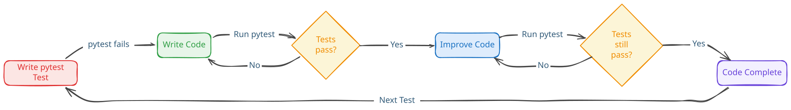

# The Project (draft/work-in-progress)

## Start

The design for this project was to find data, ask questions that a business person
in the industry of the data would want to know, and then actually analysis on it
to answer those questions and also see what strategic decisions can be made.

I was interested in doing a project at the scope that would be as close as possible
to being a data analyst in some industry. There are two challenges:

- Finding a large data set  
- Finding someone who has expertise in the domain of the data

You might ask why not start with a domain (finance, agriculture, labour, etc.)
first and then find the appropriate data? That sounds like the sensible thing to
do, but it is actually hard finding data sets that are large (> 10GBs). Even
the big players - [government, big tech, and open source][datasets] - do not have
that much in terms of size and if they do it is something that is of no interest
of me.

Another point of contingency, is that since this a project out of my own interest,
then the domain should be something of interest as well too. I would quickly find
that there would be a tug-of-war battle between *size* and *domain*.

I was interested in answering questions to do with some domain related to big
industries in Canada, I started thinking about health care since there seems to
be a lot of changes in the news and I know a few people who did the diploma
version of my program and would end up working at the healthcare provider in my
city. So that was that, I have my experts, but no data...

Low and behold, getting healthcare data that is Canadian and you can analyse
is basically impossible. On websites, such as [Government of Canada][gov] or
[Canadian Institute for Health Information][cihi], you can find and download data,
but it is clear from the output that it uses aggregated measures and cohort-level
reporting. Furthermore, the data is specific to the report it is part of, not
general purpose. In other words, raw and patient-level data is in restricted
analytical layers. This is done to reduce disclosure risks and re-identification.

At this point I was about to give up on doing something related to healthcare,
but I ended up stumbling upon [Synthea][syn] which generates *synthetic* patient
population data where each patient comes with its own health records.

## Synthea

### The good, bad, and ugly

Synthea is super cool, handy, and perhaps something maybe a healthcare provider
may develop in house for data purposes. It can output the files into several
types, but I ultimately chose [FHIR](#fhir-format) because it is a standard used
in Canada.

There was a glaring problem with Synthea... it is heavily US-based. However, I
was able to find a linked repository called [Synthea International][synint]
which allows you to change the location by downloading the appropriate files and
overwriting the default US ones.

### Discovery

In `synthea/src/main/resources/` I had to change settings in order to output FHIR
(JSON) files in the `synthea.properties` file. I noticed when scrolling through
it that this is where the CSV files are set that contain information for
geography, providers, costs, etc. that the application uses in patient generation.
Some of the file names end in `_ca` which came from the Canada folder from
Synthea International.

It hit me that I can create my own CSV files that have Canadian information in
them, dump them in the folder, and then change the value in the properties to use
that one instead. This is a tedious thing to do to find all this information
myself so I used generative AI to make me the following files:

```text
rehab_ca.csv
hospice_ca.csv
dialysis_ca.csv
home_health_agencies_ca.csv
```

Just checked to make sure that they were similar to ones that were already there
and had realistic enough data. Then in the properties file I just changed the
file it uses:

```jsonc
generate.providers.rehab.default_file = providers/rehab_ca.csv  
// was providers/rehab.csv before which has US data
```

Command to run inside synthea folder to generate data:

```bash
./run_synthea -s 42 -p 15000 "British Columbia"
```

Output: A folder in `synthea/output/` called `fhir` with 17,451 patient files, 1
practitioner file, and 1 organization file all in FHIR format of JSON type.

#### FHIR format

[ *discuss stuff here about FHIR and healthcare format standards* ] \
[ probably want to make a outline picture of what the structure of the JSON object
looks like ]

## Business Questions

After creating the data, I wanted to inspect some of the patient files to see what
information we got and it turns out we got a lot. Each patient bundle has up to
17 unique fields with some also having nested data. Inspecting the data and coming
up with questions actually became a long and lengthy process. It is really over-
whelming because it was too much information and I could in many directions with
the types of questions I can ask about the data, but instead I chose to go with
a subject of questions revolving around healthcare utilization and patient groups.

By picking a subject we can then ask a more refined question/problem and then from
there ask several sub questions:

### Business Problem

> **How do chronic disease burden and multi-morbidity affect healthcare utilization,
  and which patient groups exhibit patterns of repeated acute-care use?**

From this, we can come up with sub questions and look back at the data and see
what fields we can use and add more if we think it will help as well.

<!-- markdownlint-disable MD013 -->

| Business question | Analytical question | Why the organization cares |
| --- | --- | --- |
| **Who is using the healthcare system most heavily?** | Which patients fall into the top 5–10% by encounters, ED visits, inpatient admissions or utilization days? | Identifies populations requiring disproportionate resources |
| **What drives high utilization?** | How do age, multi-morbidity, specific chronic conditions and social factors differ between high and typical utilizers? | Helps identify characteristics associated with demand |
| **Are patients repeatedly returning to acute care?** | How many patients return to ED/acute care within 7, 30 or 90 days? | Useful for care-transition and follow-up planning |
| **Does multi-morbidity increase utilization?** | Compare patients with 0, 1, 2, 3+ chronic conditions on encounters, ED visits and inpatient use | Supports chronic-disease-management planning |
| **Which conditions create the greatest encounter burden?** | Which diagnoses are associated with the most encounters and acute-care visits? | Helps prioritize programs/resources |
| **Is care fragmented?** | How many organizations/providers does each patient see? Are high utilizers interacting with more providers? | Indicates coordination and continuity issues |
| **What happens before an acute-care event?** | Reconstruct encounters, conditions, labs, medications and procedures before ED/inpatient admission | Identifies potential intervention points |
| **How does utilization vary geographically?** | Compare patient location, provider location and organization utilization | Supports service-location and capacity planning |
| **How are chronic diseases being managed over time?** | Track labs/vitals, medications and encounters for diabetes, hypertension, CKD, etc. | Supports longitudinal quality monitoring |
| **Which patients transition to higher-support services?** | What clinical histories precede home care, hospice or other intensive services? | Supports planning for complex-care populations |

<!-- markdownlint-enable MD013 -->

Here we disclose what entries we are going to use from the patient bundles.

```jsonc
{
  'AllergyIntolerance': 15912, 
  'CarePlan': 59541, // investigate why these are the same...
  'CareTeam': 59541, // investigate why these are the same...
  'Claim': 2026390, // not useful - too American
  'Condition': 696285, // * 
  'Device': 106709, 
  'DiagnosticReport': 1105537, 
  'Encounter': 1084095, // * 
  'ExplanationOfBenefit': 2026390, // not useful - too American 
  'ImagingStudy': 87422, 
  'Immunization': 246178, 
  'MedicationRequest': 942295, // * 
  'Observation': 9736649, // * break this down & get nested information 
  'Patient': 17451, // * 
  'Procedure': 2994872, // *
  'SupplyDelivery': 491954
}
// * -> being used in analysis
```

[+ *discuss stuff here about which fields we took from each one of these resources,
consider putting in seperate files like a data dictionary* ]

<!--
    so far: ingestion -> bronze to silver::medallion -> silver to gold::up next
-->

## Let the Ingestion Begin

This is the first test and script file I made. I already had the data and this
was just a matter of putting the files into the bronze layer on Azure Data Lake
Storage Gen2. The first hard part is how we are actually going to connect to Azure
from our computer. While anything Microsoft is not my cup of tea, I will give
them this, their documents for their services are actually good.

### Azure Infrastructure

### Timeouts

### Azure Permissions

## Tech Stack

- python: script language
  - pytest: testing
  - pandas: data processing
  - pydantic: data validation
- azure: data storage and database
- quatro: report publishing
- power bi: data dashboard
- power point: business slides

## Engineer Practices

### Test-driven development

<picture>
  <source
    media="(prefers-color-scheme: dark)"
    srcset="../imgs/tdd-dark.svg"
  >
  <source
    media="(prefers-color-scheme: light)"
    srcset="../imgs/tdd-light.svg"
  >
  
</picture>

> *"If you can't write a unit test, don't come near my data pipelines" - professor*

I had done [TDD][article] in my 2nd year capstone (TypeScript + Chai + Mocha) project
and I wanted to continue improving this skill. There is so much about testing that
I have not fully understood or done yet - mocks, spies, end-to-end integration,
etc. It is important to the quality of the project that the data pipelines are
easy to reason about, safe to refactor, and robust against irregularities in the
nested FHIR data.

### Dependency injection/fake for Azure tests

One of the confusing tests that I had to wrap my head around was *Fakes*. I got
stuck here in thinking how do you test the cloud, but in reality I just needed to
understand the behaviour of what the service is doing. So what are we doing with
the data?

When we upload data into Azure for ingestion we are simply storing it. So we
just need to implement a *fake* storage that behaves like the one in our cloud.
I had generative AI help me at this step because I am not well versed in Python
object orientated programming (a.k.a POOP). None the less, we can verify storage
upload and behaviour and that is exactly what we wanted. Also, by testing the
infrastructure code from the transformation behaviour we gave ourselves a bonus
of reduced coupling between the systems.

### Logging

There is something about having several files that need to coordinate with one another,
but we can not see the coordination happening. It becomes really difficult to observe
the pipeline in action or even trace where errors happen. This is why I wanted
to add logging and Python already has a good library built-in. I want to log the
major steps happening, warnings, and errors. I do not need to see every successful
action because that log file will get big with unnecessary information.

A lot of thought was given to where to put the logging and how to set it up. I
was able to do this through reading docs, googling around about best practices,
and doing test runs with a small batch of files. Another thing is that a pipeline
(or any software for that matter) is not production-like if you have to sit
around staring at the terminal to see things happening. I should be able to run
my pipeline and comeback to it once it is finished and inspect the logs to see if
something happened and figure out why.

### Docker development environment

I wanted to create an isolated and reproducable environment so I can work on it
from both my laptop and PC. I did not want environment-specific issues which I
was already having on my laptop anyways. The goal with the container was to keep
it light weight and use it as a runtime so that way I can keep using my workflow
setup (Neovim + Git) on my host device. I had to generate some keys from Azure that
live on my machine that the container reads in order to connect and interact with
Azure.


[datasets]: https://github.com/DataTalksClub/data-engineering-zoomcamp/blob/main/projects/datasets.md
[gov]: https://www.canada.ca/en/services/health/data.html
[cihi]: https://www.cihi.ca/en
[syn]: https://github.com/synthetichealth/synthea
[synint]: https://github.com/synthetichealth/synthea-international/tree/master
[article]: https://martinfowler.com/bliki/TestDrivenDevelopment.html
